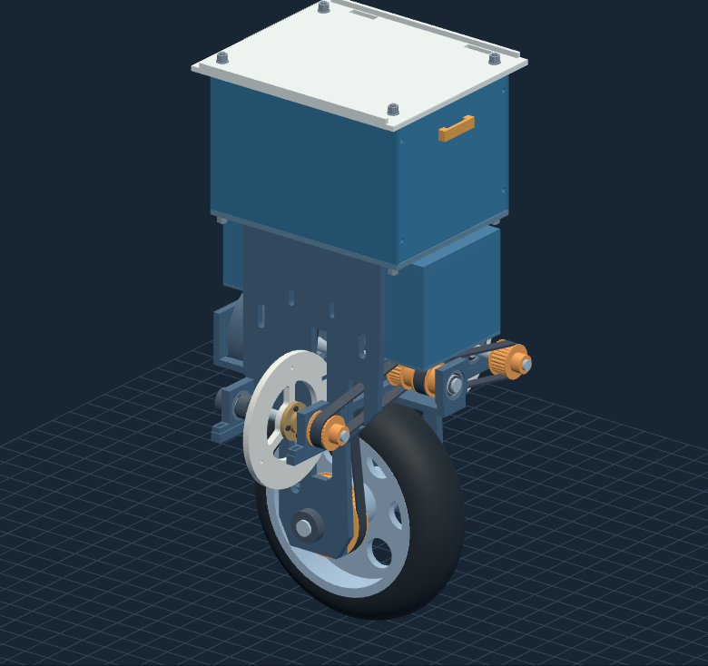

# GyroRoll CAD · R1B

GyroRoll 双飞轮独轮机器人的机械总装与采购清单。R1B 使用一台 MAD M6C12 驱动两只平行轴的国产三辐条惯性轮，SteadyWin DD9015-1 通过同步带驱动滚动轮。两只飞轮外径 100 mm、通孔 8 mm。



## CAD 与采购

| 文件 | 用途 |
|---|---|
| [离线三维预览](cad/index.html) | 将仓库下载到本地后，用浏览器打开，可查看零件、传动和爆炸图 |
| [总装 STEP](cad/GyroRoll_stock_inertia_R1B.step) | 毫米制装配，含零件名称 |
| [单片飞轮 STEP](cad/GyroRoll_R1B_flywheel_D100_bore8_envelope.step) | 三辐条轮盘、轮毂和螺钉的试装模型 |
| [打印试装件](cad/print_fit_check/parts.tsv) | 15 个 STL，清单记录零件和摆放尺寸 |
| [机械 BOM（Excel）](bom/GyroRoll_机械采购BOM_R1B.xlsx) · [CSV](bom/mechanical-bom-r1b.csv) | 单台用量、采购入口、订购规格和试装条件 |
| [飞轮采购与规格说明](bom/flywheel-sourcing.md) | 商品规格、参考照片及验收项目 |

盘厚 5 mm、含轮毂总宽 12 mm，以及辐宽和小孔尺寸属于建模估算。滚动轮为 Ø175 × 50 mm 外形占位，轮毂连接尺寸随实物定型。质量和质心为 [模型估算](cad/mass_properties.json)。

## 重建

使用 Python 3.12。在 [SteadyWin DD9015 官方页面](https://steadywin.cn/en/h-pd-172.html) 下载电机 STEP，并放到 `src/DD9015_supplier.step`。

```sh
python -m pip install -r requirements.txt
python src/build.py
```

生成的模型、预览和试装 STL 写入 `cad/`。查看 [第三方资料与来源](THIRD_PARTY.md)。
