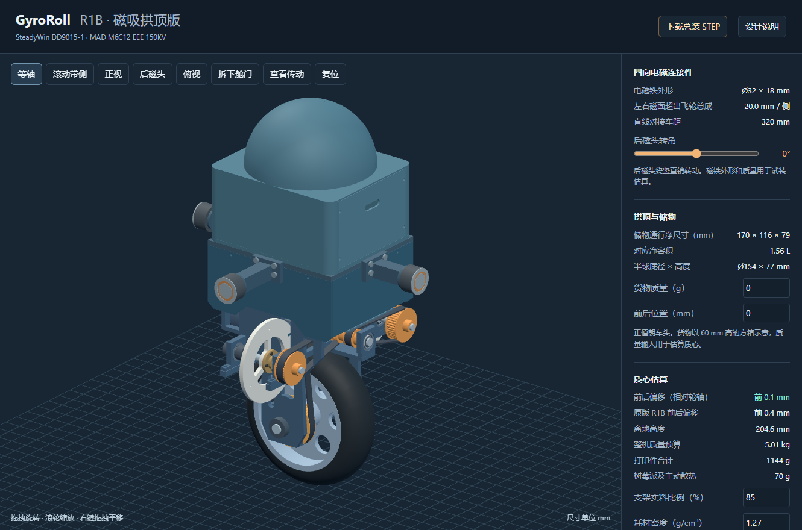

# GyroRoll CAD · R1B

GyroRoll 双飞轮独轮机器人的 CAD 与机械采购清单。R1B 采用两只 Ø100 mm、通孔 Ø8 mm 的三辐条惯性轮。MAD M6C12 经同步带驱动双飞轮，SteadyWin DD9015-1 驱动滚动轮。

## R1B 磁吸平肩半球版

最新版采用四向电磁连接，后磁头可绕竖轴摆动。Ø154 mm 正半球直接落在水平肩面上，双飞轮以 20T → 40T、2∶1 同步驱动。



[离线三维预览](cad/magnetic/index.html) · [总装 STEP](cad/magnetic/GyroRoll_R1B_magnetic_dome.step) · [打印件清单](cad/magnetic/print_fit_check/parts.tsv) · [设计说明](cad/magnetic/README.md)

## R1B 齐平机身与中央车钩版


齐平机身的承力框、储物箱和顶平台共用 **180 × 154 mm** 外廓，储物通行净尺寸 **170 × 128 × 106 mm**。电子舱有可拆式检修板。

支架和外壳改用 3D 打印方案后，单机空载估算 **4.69 kg**，含 225 g 电池。打印件净质量约 **1.09 kg**。按 PETG **1.27 g/cm³**、承力件 **85% 有效实料**、薄壁件实心估算。三维页面可调整耗材密度和实料比例。[机身与质量说明](cad/body-print.md) · [逐件质量与质心](cad/mass_properties.json)

## CAD 与采购

| 文件 | 用途 |
|---|---|
| [单机三维预览](cad/index.html) | 下载仓库后在浏览器中打开，可查看零件、传动、爆炸图和质心 |
| [总装 STEP](cad/GyroRoll_stock_inertia_R1B.step) | 毫米制总装，含零件名称 |
| [单片飞轮 STEP](cad/GyroRoll_R1B_flywheel_D100_bore8_envelope.step) | 三辐条轮盘、轮毂及螺钉的试装模型 |
| [外壳与舱体试装件](cad/print_fit_check/parts.tsv) | 清单和同目录的 11 个 STL |
| [机械 BOM（Excel）](bom/GyroRoll_机械采购BOM_R1B.xlsx) · [CSV](bom/mechanical-bom-r1b.csv) | 单台用量、采购入口、规格与试装条件 |
| [飞轮采购与规格说明](bom/flywheel-sourcing.md) | 商品规格、参考照片及验收项目 |

飞轮盘厚、轮毂宽度、辐宽和小孔尺寸以样件复核为准。滚动轮用 Ø175 × 50 mm 模型占位。承力打印件需要验证刚度、层间强度及轴承座保持方式。

## 四机连接

同排主轮距 340 mm，直行排距 450 mm。两排由中央 H 铰接，刚性货架通过前转盘与后转盘滑块支承。交互模型支持单机收纳、四机折转及隐藏货架。[交互模型](cad/coupling/index.html) · [四机总装 STEP](cad/coupling/GyroRoll_R1B_connection_four.step) · [连接件说明](cad/coupling/README.md)

## 重建

使用 Python 3.12。在 [SteadyWin DD9015 官方页面](https://steadywin.cn/en/h-pd-172.html) 下载电机 STEP，放到 `src/DD9015_supplier.step`。

```sh
python -m pip install -r requirements.txt
python src/build.py
python src/coupling/build_connections.py
python src/magnetic/build_magnetic.py
```

齐平版单机输出位于 `cad/`，中央车钩版输出位于 `cad/coupling/`，磁吸平肩半球版输出位于 `cad/magnetic/`。[第三方资料与来源](THIRD_PARTY.md)
